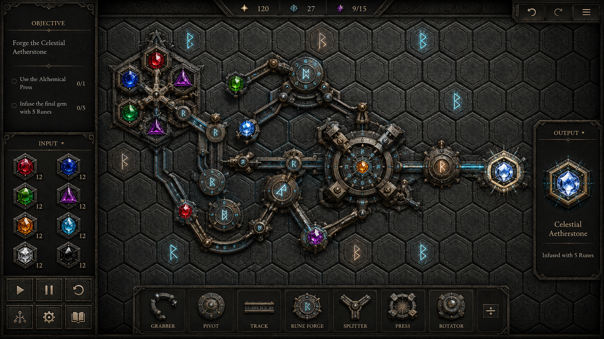

# Runik

*An Opus Magnum-style transmutation puzzle game where the machine **is** the
inscription.* Built with Unreal Engine 5.8 (C++/Slate, no Blueprints).

You are Eir Runasdottir, last apprentice of the Runewrights' Guild. Inscribe
Elder Futhark runes on a hex board to pull, push, spin, fuse, sunder and
plane-shift gems - build a machine that runs on its own and delivers what each
puzzle demands, then compete against par on cost, ticks and rune count.



## The six runes

| Rune | Glyph | Effect |
| --- | --- | --- |
| Pull | Nauthiz ᚾ | Draws the first thing on each of its six axes (range 3) one hex closer each tick; holds fast whatever stands beside it. |
| Push | Thurisaz ᚦ | Everything adjacent moves one hex directly away. |
| Orbit | Raidho ᚱ | Everything adjacent rotates around it - **sunwise** on the Material plane, **widdershins** on the Ethereal. |
| Fuse | Gebo ᚷ | After movement, adjacent entities that touch each other are bonded into one rigid compound. |
| Detach | Kenaz ᚲ | Severs every bond touching an adjacent entity. |
| Shift | Dagaz ᛞ | Flips adjacent units to the other plane, if their hexes are free there. |

**Two planes** run at once: Material (runes burn gold) and Ethereal (runes glow
blue). They have independent occupancy; only Dagaz crosses between them.

**Runes obey runes.** Every rule applies to runes as well as gems. A rune only
affects things of *strictly lower rank* (priority 1-9, you assign it), so a
rank-3 pull can drag a rank-1 push rune across the board - or be immune to it.
Equal-rank conflicts cancel: the stone hears only silence.

## Repository layout

```
Runik.uproject            UE 5.8 project (OnlineSubsystemSteam enabled)
Config/                   engine/game/input ini
Source/Runik/Core/        engine-agnostic simulation, puzzles, GIF encoder
Source/Runik/Game/        UE glue: assets, audio, save, GIF renderer, GameMode
Source/Runik/UI/          Slate UI: menus, campaign, board editor, histograms
Content/SourceArt/        original gem sheet / hex tile / board art
Content/Raw/              processed sprites (chroma-keyed gems, rune glyphs, icons)
Content/Audio/            procedurally synthesized SFX + ambient beds
Tools/                    asset pipeline (python) + packaging script
Tests/                    standalone core test suite (no Unreal needed)
docs/                     design, story bible, Steam checklist
```

## Building

1. Install **Unreal Engine 5.8** from the Epic Games Launcher and
   Visual Studio 2022 with C++ game development workload.
2. Right-click `Runik.uproject` → *Generate Visual Studio project files*.
3. Open the solution, build `RunikEditor` (Development Editor | Win64), then
   launch the .uproject - or package directly with `Tools/package_win64.bat`.

The whole game boots from the engine's empty Entry map; everything (board,
menus, campaign) is Slate spawned by `ARunikGameMode`.

> Note: the core simulation, puzzles and GIF encoder are fully machine-tested
> on the plain VS toolchain (see below). The UE-side module was written against
> the UE 5.x Slate/Engine API but has not yet been compiled on this machine -
> the dev box only had a partial engine install. Expect at most minor
> include/API touch-ups on first build.

## Tests (no Unreal required)

```
Tests\build_and_run.bat
```

Compiles the simulation with plain VS 2022 and verifies every rune mechanic
plus **all 15 campaign puzzles** against their reference solutions (49 checks),
and writes a sample animated GIF from the built-in encoder.

## Asset pipeline

```
python Tools/process_gems.py   # slice 4x4 gem sheet, chroma-key the pink bg
python Tools/gen_runes.py      # draw Elder Futhark glyph sprites + UI icons
python Tools/gen_sfx.py        # synthesize all SFX / ambient WAVs
```

Outputs land in `Content/Raw` and `Content/Audio` and are loaded at runtime
(no .uasset imports needed).

## Features

- 5-chapter campaign (15 hand-verified puzzles) with story interstitials
- Open-ended machine editor: rune palette, rank (priority) editing, plane
  switching, run/pause/step/reset, adjustable machine speed
- Metrics + histogram comparer (cost / ticks / runes vs par distribution)
- Animated **GIF export** of your running machine (built-in GIF89a encoder)
- Procedural audio (chimes, whooshes, drones - all synthesized by the repo)
- JSON save with per-puzzle best scores and saved machines
- Steam-ready configuration (see `docs/STEAM.md`)

## Controls

| Input | Action |
| --- | --- |
| Left click | Inscribe selected rune / cycle rank of an existing rune |
| Right click | Erase rune |
| Mouse wheel | Adjust rank under cursor |
| Tab | Switch inscription plane (Material/Ethereal) |
| 1-9 | Set rank for new inscriptions |
| Space / S / R | Run-pause / step / reset |
| Esc | Back |
